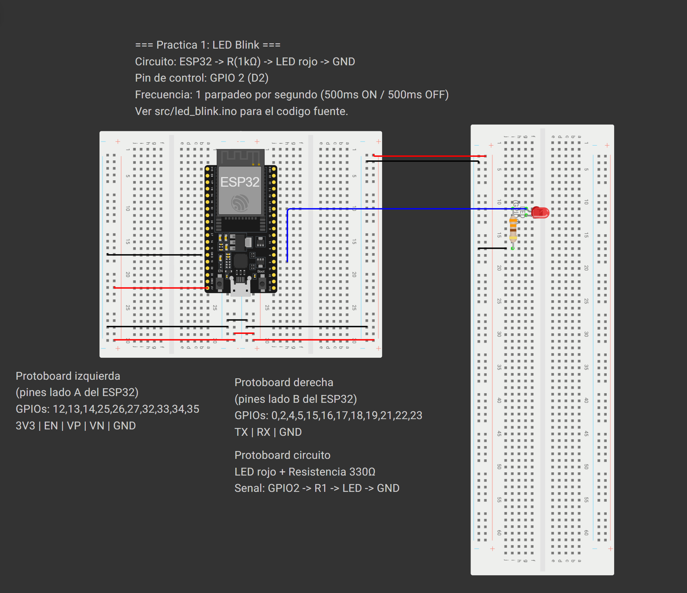

# 🚀 Starter Kit — ESP32 con Wokwi + PlatformIO

> **Repositorio plantilla** para estudiantes de la materia.  
> Contiene un proyecto básico de parpadeo de LED (Blink) listo para simular en Wokwi y cargar en una placa ESP32 física.

---

## 📋 Tabla de Contenidos

1. [¿Qué incluye este repositorio?](#qué-incluye-este-repositorio)
2. [Requisitos previos](#requisitos-previos)
3. [Paso 1 — Instalar el driver del ESP32 (CP210x)](#paso-1--instalar-el-driver-del-esp32-cp210x)
4. [Paso 2 — Instalar VS Code y extensiones](#paso-2--instalar-vs-code-y-extensiones)
5. [Paso 3 — Clonar este repositorio como tuyo](#paso-3--clonar-este-repositorio-como-tuyo)
6. [Paso 4 — Simular con Wokwi](#paso-4--simular-con-wokwi)
7. [Paso 5 — Editar el diagrama en wokwi.com](#paso-5--editar-el-diagrama-en-wokwicom)
8. [Paso 6 — Cargar el código en tu ESP32 físico](#paso-6--cargar-el-código-en-tu-esp32-físico)
9. [Estructura del proyecto](#estructura-del-proyecto)
10. [¿Cómo hacer este repositorio tuyo?](#cómo-hacer-este-repositorio-tuyo)

---

## ¿Qué incluye este repositorio?

| Archivo / Carpeta | Descripción |
|---|---|
| `src/led_blink.ino` | Código principal: parpadeo de LED en GPIO 2 |
| `diagram.json` | Circuito virtual (ESP32 + resistencia + LED azul) |
| `platformio.ini` | Configuración del proyecto PlatformIO |
| `wokwi.toml` | Configuración del simulador Wokwi |
| `.gitignore` | Archivos a ignorar en git (excluye `.pio/`) |

---

## Requisitos previos

- Computadora con Windows 10/11 (también funciona en macOS/Linux)
- Conexión a Internet
- Una placa **ESP32 DevKit** (para carga física, opcional si solo simulas)

---

## Paso 1 — Instalar el driver del ESP32 (CP210x)

La mayoría de las placas ESP32 DevKit usan el chip **CP2102** de Silicon Labs para la comunicación USB-Serial. Sin este driver, tu computadora no reconocerá la placa.

### ¿Cómo saber si necesitas instalarlo?

1. Conecta tu ESP32 por USB
2. Abre el **Administrador de dispositivos** (clic derecho en Inicio → Administrador de dispositivos)
3. Si ves un dispositivo con signo de advertencia ⚠️ o "Dispositivo desconocido", necesitas el driver

### Instalación

1. Ve a la página oficial de Silicon Labs:  
   👉 **https://www.silabs.com/software-and-tools/usb-to-uart-bridge-vcp-drivers?tab=downloads**

2. Descarga el instalador para tu sistema operativo:
   - Windows: `CP210x_Windows_Drivers.zip`
   - macOS: `CP210x_Mac_VCP_Driver.zip`

3. Descomprime el ZIP y ejecuta `CP210xVCPInstaller_x64.exe` (en Windows 64-bit)

4. Sigue el asistente de instalación y reinicia si se te pide

5. Vuelve a conectar el ESP32 → en el Administrador de dispositivos debería aparecer como:  
   `Silicon Labs CP210x USB to UART Bridge (COM3)` *(el número COM puede variar)*

> ⚠️ **Nota:** Si tu placa usa el chip CH340 en lugar de CP2102, necesitas un driver diferente. Puedes identificarlo mirando el chip pequeño cerca del conector USB en la placa.

---

## Paso 2 — Instalar VS Code y extensiones

### 2.1 — Visual Studio Code

1. Descarga VS Code desde: **https://code.visualstudio.com/**
2. Instala con las opciones predeterminadas
3. Abre VS Code

### 2.2 — Extensión PlatformIO IDE

PlatformIO es el entorno de desarrollo que usamos para compilar y cargar código al ESP32.

1. En VS Code, abre la pestaña de extensiones (ícono de cuadros en la barra izquierda, o `Ctrl+Shift+X`)
2. Busca: `PlatformIO IDE`
3. Instala la extensión de **PlatformIO** (autor: PlatformIO)
4. Espera a que termine la instalación (puede tardar unos minutos la primera vez)
5. Reinicia VS Code cuando se te pida

### 2.3 — Extensión Wokwi for VS Code

Wokwi permite simular tu ESP32 directamente en VS Code, sin necesitar la placa física.

1. En la pestaña de extensiones busca: `Wokwi`
2. Instala la extensión **Wokwi Simulator** (autor: Wokwi)
3. La primera vez que la uses, te pedirá activar una **licencia gratuita** — solo necesitas una cuenta en [wokwi.com](https://wokwi.com)

---

## Paso 3 — Clonar este repositorio como tuyo

Tienes dos opciones:

### Opción A — Usar "Use this template" (recomendado)

1. En GitHub, haz clic en el botón verde **"Use this template"** → **"Create a new repository"**
2. Elige tu cuenta como destino
3. Dale un nombre a tu repositorio
4. Clona tu nuevo repositorio en tu computadora:
   ```bash
   git clone https://github.com/TU_USUARIO/TU_REPO.git
   cd TU_REPO
   code .
   ```

### Opción B — Clonar y limpiar el historial (ver sección final)

Ve directamente a la sección [¿Cómo hacer este repositorio tuyo?](#cómo-hacer-este-repositorio-tuyo)

---

## Paso 4 — Simular con Wokwi



1. Abre la carpeta del proyecto en VS Code:  
   `Archivo → Abrir Carpeta...` → selecciona la carpeta del proyecto

2. Espera a que PlatformIO indexe el proyecto (barra inferior mostrará progreso)

3. **Compila el proyecto** primero:
   - Presiona `Ctrl+Shift+P` → escribe `PlatformIO: Build` → Enter
   - O haz clic en el ícono ✓ en la barra inferior de VS Code

4. **Inicia el simulador**:
   - Presiona `F1` → escribe `Wokwi: Start Simulator` → Enter
   - O presiona `Ctrl+Shift+P` → `Wokwi: Start Simulator`

5. Verás el circuito simulado: el LED azul debería parpadear cada 500ms

6. Abre el **Monitor Serial** en Wokwi para ver los mensajes `LED Encendido / LED Apagado`

---

## Paso 5 — Editar el diagrama en wokwi.com

Si quieres agregar más componentes al circuito (botones, sensores, pantallas, etc.), puedes editar el diagrama visualmente:

1. Ve a **https://wokwi.com** e inicia sesión con tu cuenta

2. Haz clic en **"New Project"** → selecciona **ESP32**

3. En la interfaz, haz clic en el botón **"+"** para agregar componentes desde la biblioteca

4. Conecta los componentes arrastrando cables entre los pines

5. Cuando termines, ve al menú **"File"** → **"Download as ZIP"** o copia el contenido del archivo `diagram.json` que genera Wokwi

6. Pega el contenido del nuevo `diagram.json` en tu proyecto VS Code (reemplaza el archivo existente)

### Estructura del `diagram.json`

```json
{
  "version": 1,
  "parts": [
    { "type": "board-esp32-devkit-c-v4", "id": "esp" },
    { "type": "wokwi-led", "id": "led1", "attrs": { "color": "red" } }
  ],
  "connections": [
    [ "esp:2", "led1:A", "green", [] ],
    [ "esp:GND.1", "led1:C", "black", [] ]
  ]
}
```

- **`parts`**: lista de componentes con su tipo, ID y posición
- **`connections`**: cables entre pines `["origen", "destino", "color", [ruta]]`
- Los tipos de componentes disponibles están en: https://docs.wokwi.com/parts/

---

## Paso 6 — Cargar el código en tu ESP32 físico

1. Conecta tu ESP32 por USB (asegúrate de que el driver esté instalado — ver Paso 1)

2. En VS Code, en la barra inferior de PlatformIO verás el puerto detectado automáticamente

3. Haz clic en el botón **→ (Upload)** en la barra inferior, o presiona `Ctrl+Shift+P` → `PlatformIO: Upload`

4. Si el upload falla con error de puerto:
   - Revisa el Administrador de dispositivos para confirmar el número de COM
   - Agrega al `platformio.ini`:
     ```ini
     upload_port = COM3   ; cambia por tu puerto
     ```

5. Una vez cargado, el LED de tu ESP32 debería parpadear ✅

6. Abre el **Monitor Serial** de PlatformIO: clic en el ícono 🔌 en la barra inferior → verás los mensajes en tiempo real

---

## Estructura del proyecto

```
Starter-kit/
├── src/
│   └── led_blink.ino      # Código fuente principal
├── diagram.json            # Circuito virtual para Wokwi
├── platformio.ini          # Configuración de PlatformIO
├── wokwi.toml              # Configuración del simulador
├── .gitignore              # Archivos excluidos de git
└── README.md               # Este archivo
```

---

## ¿Cómo hacer este repositorio tuyo?

Este repositorio está diseñado como **punto de partida**. Para cada nueva práctica:

1. Clona o descarga el repositorio:
   ```bash
   git clone https://github.com/UETS-Soporte-Tecnico/Starter-kit.git mi-proyecto
   cd mi-proyecto
   ```

2. **Borra la carpeta `.git`** (historial de versiones del repositorio original):
   ```powershell
   # En PowerShell (Windows)
   Remove-Item -Recurse -Force .git
   ```
   ```bash
   # En Bash (macOS/Linux)
   rm -rf .git
   ```

3. Inicia tu propio repositorio:
   ```bash
   git init
   git add .
   git commit -m "Inicio de práctica - [nombre de la práctica]"
   ```

4. Sube a **tu propio** repositorio en GitHub:
   ```bash
   git remote add origin https://github.com/TU_USUARIO/TU_REPO.git
   git push -u origin main
   ```

---

## 📚 Recursos adicionales

| Recurso | Enlace |
|---|---|
| Documentación Wokwi | https://docs.wokwi.com |
| Documentación PlatformIO | https://docs.platformio.org |
| Driver CP210x (Silicon Labs) | https://www.silabs.com/software-and-tools/usb-to-uart-bridge-vcp-drivers |
| Referencia ESP32 Arduino | https://espressif-docs.readthedocs-hosted.com |
| Comunidad PlatformIO | https://community.platformio.org |

---

<div align="center">

**UETS — Soporte Técnico**  

</div>
